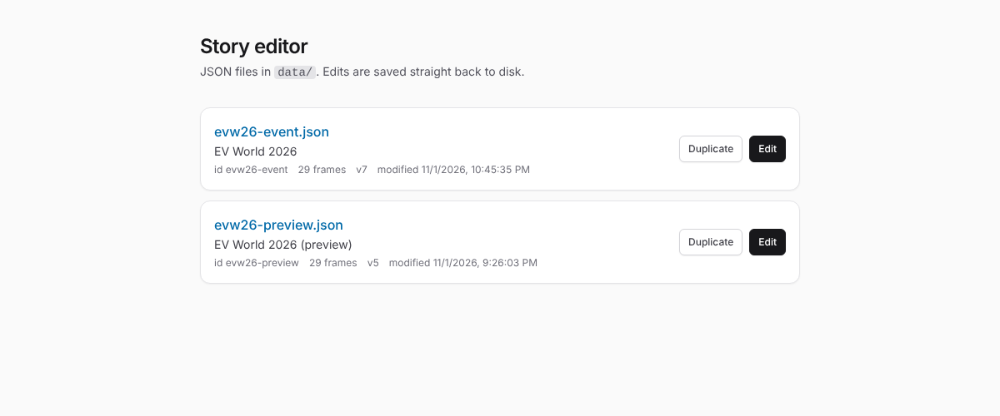
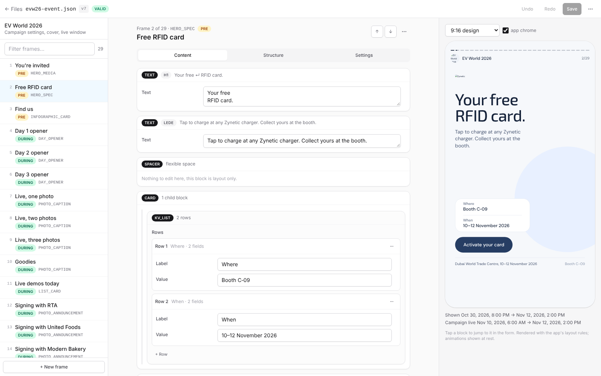
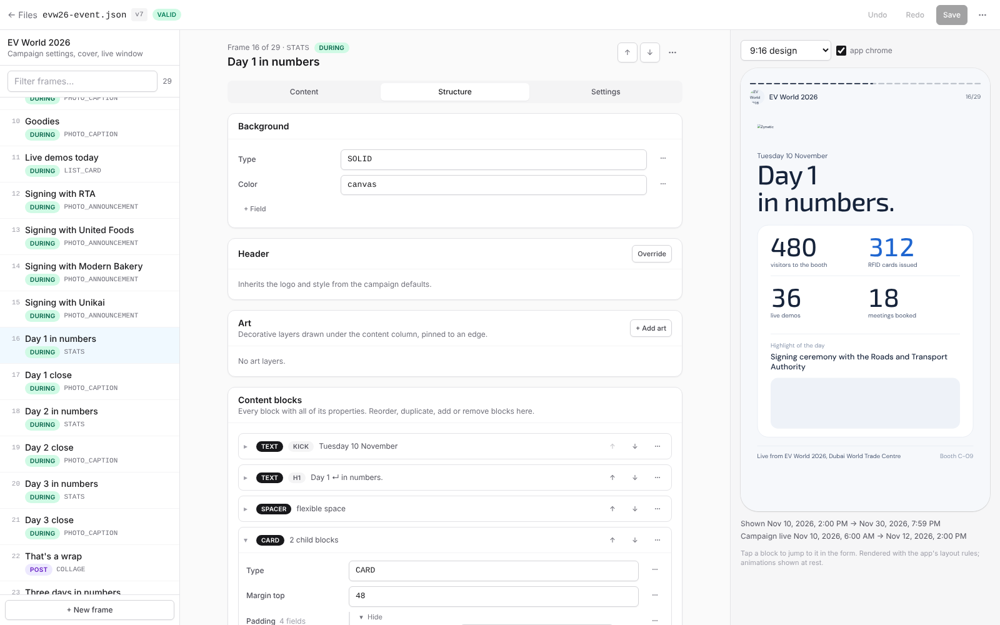
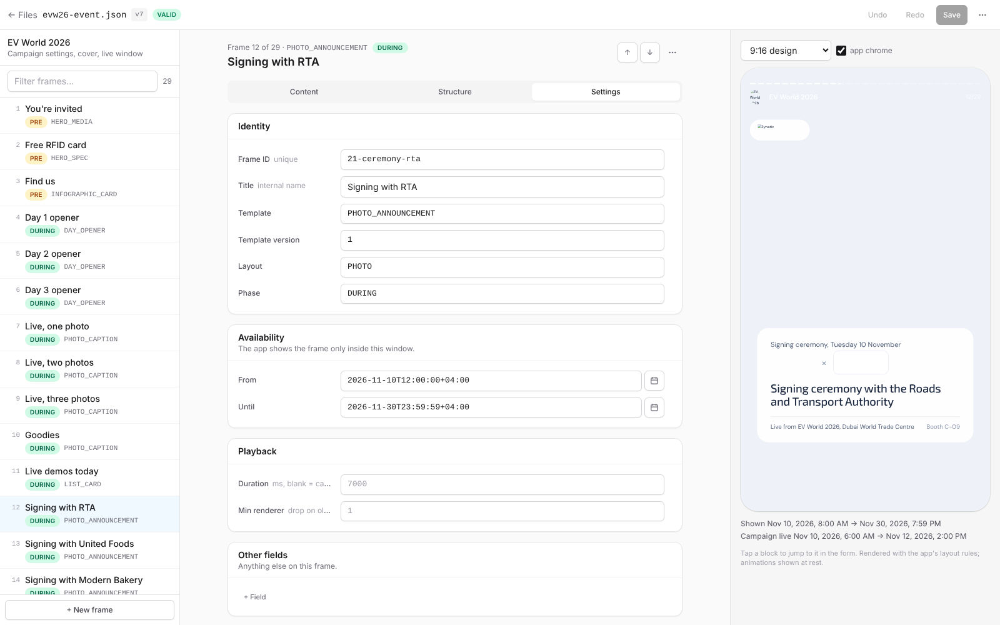
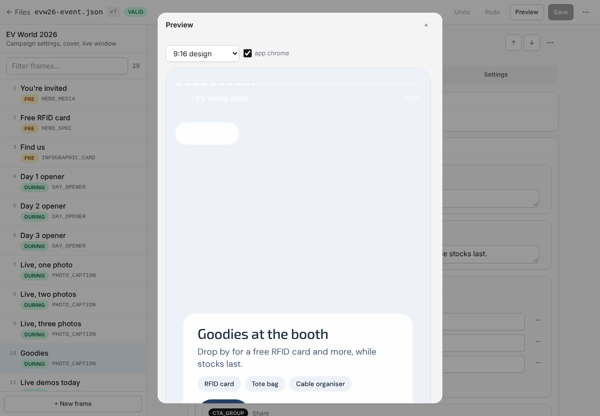
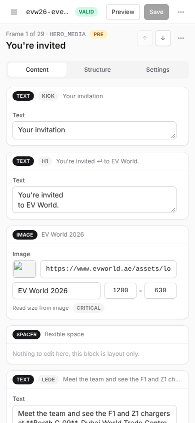
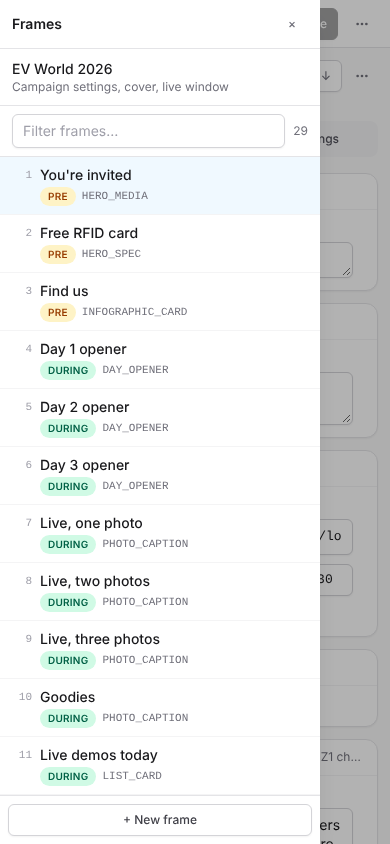

# Story editor

A local web app for editing the story/campaign JSON files (e.g. `evw26-event.json`,
`evw26-preview.json`). Built with **TanStack Start** (TanStack Router + Vite + React 19),
Tailwind CSS and Zod. Server functions read and write the files on disk, so saving in the
browser updates the file directly — no copy/paste.

## Screenshots

Taken from the running app at desktop, laptop and phone widths (the sandbox they were captured
in had no access to the image CDNs, so photos and logos show their placeholder colour).

| | |
|---|---|
| **Files** — the JSON files in `data/`  | **Content tab** — copy, values and images per block, with the live preview  |
| **Structure tab** — the full block tree with every property  | **Settings tab** — identity, availability, playback  |
| **Laptop** — the preview opens as a sheet  | **Phone** — stacked form and the frame drawer   |

## Run it

```bash
npm install
npm run dev
```

Open <http://localhost:3000>. The files in `data/` are listed on the home page.

To point it at a different folder of JSON files:

```bash
DATA_DIR=/path/to/your/json npm run dev
```

## What you can do

The editor works from phone width up. On wide screens it is three columns (frames · form ·
preview); on laptops the preview opens as a sheet from the **Preview** button; on phones the
frame list is a drawer behind the ☰ button. Form labels sit beside their inputs when there is
room and above them when there is not.

- **Campaign** panel: id, title, subtitle, priority, locale, live window, cover, defaults, theme.
- **Frames** sidebar: filter, select, add; frames with validation problems show a red count.
  Move a frame with ↑/↓ in the frame header, duplicate or delete it from the frame's ⋯ menu.
- **Frame** editor, three tabs:
  - **Content** — just the things people change: copy, labels, values, images, list rows,
    buttons, grouped per block (and per child block inside cards and glass panels). Layout and
    style props are left out of this view. Images are a compact field (URL with thumbnail, alt,
    width × height, "read size from image").
  - **Structure** — the full tree: background, header override, art layers and every content
    block with all of its properties. Blocks collapse to a one-line summary; reorder, duplicate,
    remove, and **+ Add block** with a starter template for every block type in the catalogue.
    Each row has a ⋯ menu to rename the field, change its type or remove it.
  - **Settings** — id, title, template, layout, phase, availability window (single input with a
    native date-time picker that keeps the `+04:00` offset), duration and renderer version.
- **Click a block in the preview** to jump to it in the form (it scrolls into view and
  highlights). Works in the side pane and in the preview sheet.
- **Preview** (right column, wide screens): renders the selected frame the way the app's Compose
  renderer does (see `ev-world-stories-sdui-api-design`, §3, §4, §6, §12):
  - 1080-du artboard scaled to fit; z-order background → pinned art → content column
    (padding 240 / 72 / 300) → app chrome (progress segments, title row);
  - header row 56 du with the 50 du logo (plain, or in a glass pill), then blocks top to bottom;
    `SPACER` takes the extra height on tall screens, art is pinned `TOP` / `BOTTOM` / `CENTER`;
  - colour tokens (`canvas`, `ink`, `navy`, `blueInk`, `lime`, `glass`, …) with `theme.colors`
    overrides, and the Exo 2 / DM Sans type ramp (`XL` … `LIVE`) with per-block `size` /
    `lineHeight` / `color` / `textAlign` / `maxLines`;
  - every block in the catalogue, including `COUNTDOWN` (ring and numeral), `CHARGE_BAR`,
    `POLL`, `CAROUSEL`, `PRODUCT_GRID`, `PEOPLE_GRID`, `TEXT_LINES`, `DOT_MATRIX`, `HALL_MAP`;
    unknown block types show a dashed placeholder noting whether the app would skip the block or
    drop the frame (`required`);
  - glass panels are a plain 92 % white fill, no blur, as in the app; images fall back to their
    `placeholderColor` (`mist`) while loading or on error.
  - Switch between the 9:16 design artboard and taller phones (19.5:9, 20:9) to check spacer and
    pin behaviour; toggle the app chrome; enlarge the pane with `+`.
  - Not simulated: the countdown uses the browser clock (the app uses server time), and
    animations (live dot, charge bar loop, ring ticks, poll bars) are shown at rest.
  - Below the preview: the frame's availability window next to the campaign's live window.
- **Raw JSON**: edit the whole document as text and apply.
- **Validation**: Zod schema checks required fields, ISO date format, enums and duplicate frame ids.
  Click the issue count in the top bar to list them; clicking an issue jumps to the frame.
- **Save** (`Ctrl/⌘+S`) writes pretty-printed JSON back to `data/<file>.json`. "bump version"
  increments the document `version` on each save (toggle in the top bar). **Download** gives you
  the current JSON as a file without saving. **Undo/Redo**: `Ctrl/⌘+Z`, `Ctrl/⌘+Shift+Z`.
- **Duplicate** a file from the home page (e.g. make `evw26-preview.json` from the event file).

## Layout

```
data/                      the JSON files you edit
src/routes/index.tsx       file list
src/routes/edit.$file.tsx  editor route (loads the file via a server function)
src/lib/files.ts           server functions: list / read / write / duplicate
src/lib/schema.ts          Zod schema, enum suggestions, block & frame templates
src/lib/jsonPath.ts        immutable JSON path helpers
src/components/Editor.tsx  editor UI (campaign, frames, blocks, raw)
src/components/JsonNode.tsx generic recursive JSON editor
src/components/FramePreview.tsx approximate frame preview
```

To add a new block type to the "Add block" palette, extend `CONTENT_TYPES` and `blockTemplate()`
in `src/lib/schema.ts`; to add enum suggestions for a key, extend `ENUMS` there.

## Production build

```bash
npm run build
npm run start
```
